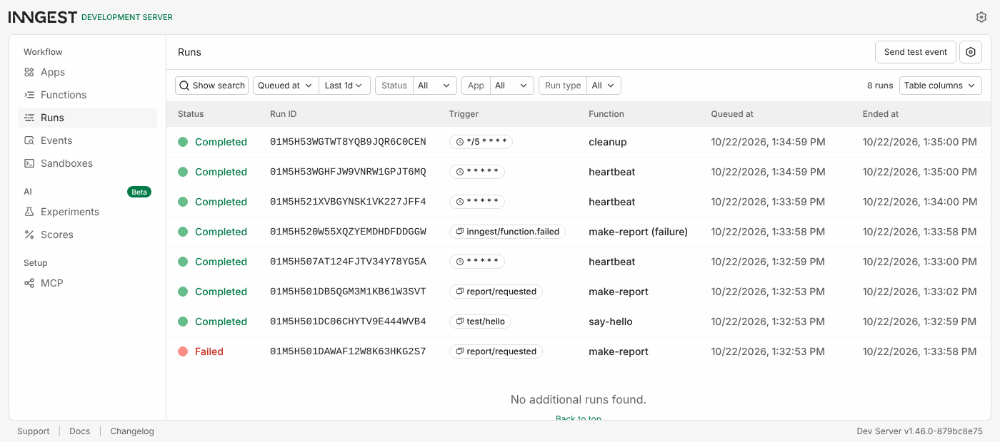
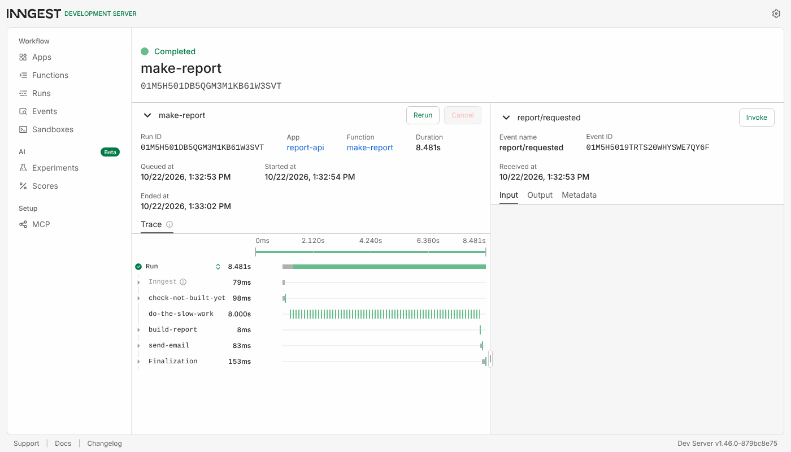
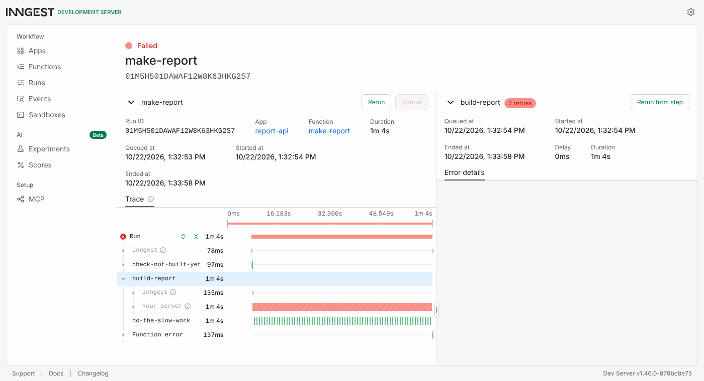

# Report API with background jobs (FlyRank Backend track, A7)

A small **FastAPI** service whose slow work runs as a **background job** on **Inngest**. It follows three rules:

- **Accept fast:** `POST /reports` answers **202** in about 10 ms.
- **Work in the background:** an 8-second job builds the report.
- **Report status:** `GET /reports/{id}` shows `pending` first, then `done`.

A **cron job** also runs on the clock alone, with no request at all.

## Run it: two terminals, one command each

Needs Python 3.10+ and Node.js (only for `npx`, which runs the Inngest Dev Server; no account and no card).

```powershell
python -m venv .venv; .\.venv\Scripts\Activate.ps1      # macOS/Linux: source .venv/bin/activate
pip install -r requirements.txt
```

| Terminal | Command | What runs |
|---|---|---|
| 1 | `uvicorn main:app --reload` | The API on http://localhost:8000 (Swagger at `/docs`) |
| 2 | `npx inngest-cli@latest dev -u http://localhost:8000/api/inngest` | The Dev Server + dashboard on http://localhost:8288 |

Then run `curl.exe -i -X POST http://localhost:8000/reports -H "Content-Type: application/json" -d '{\"topic\":\"cats\"}'`,
and poll `GET /reports/<id>` until it says `done`.

Tests: `pip install -r requirements-dev.txt` then `pytest -q`. All **10 pass**. They cover the API side: 202 + exactly
one event, 404, 400 with no event, and the list endpoint. The functions themselves were checked end-to-end against the Dev
Server, as shown below.

## Endpoints

| Method | Path | What it does | Status |
|---|---|---|---|
| GET | `/health` | Liveness | 200 `{"status":"ok"}` |
| POST | `/reports` | `{"topic":"cats"}` → saves `pending`, sends event `report/requested`, returns `{"id","status":"pending"}` | **202** · 400 if the topic is missing or empty (no event sent) |
| GET | `/reports/{id}` | `pending` → `done` + `result` (or `failed` + `error`) | 200 · 404 |
| GET | `/reports` *(extra)* | Every report and its status | 200 |
| * | `/api/inngest` | Where the Dev Server finds and calls the functions | — |

## Functions

| Function | Trigger | Steps / behaviour |
|---|---|---|
| `say-hello` | event `test/hello` | `step.sleep` 5 s → returns `"Hello from the background!"` |
| `make-report` | event `report/requested` | `check-not-built-yet` → `step.sleep("do-the-slow-work", 8s)` → `step.run("build-report")` → `step.run("send-email")`. `retries=2`, `concurrency=2`, and an `on_failure` handler marks the report `failed` |
| `heartbeat` | cron `* * * * *` | Logs `heartbeat: X pending, Y done, Z failed` |
| `cleanup` *(extra)* | cron `*/5 * * * *` | Forgets `done` reports older than 10 minutes |

The store is an in-memory dict (`store.py`), so it forgets everything on restart. That's expected at this stage.

## Proof: 202, then two polls (a real run)

```text
$ time curl -i -X POST http://localhost:8000/reports -H "Content-Type: application/json" -d '{"topic":"cats"}'
HTTP/1.1 202 Accepted
{"id":"5bae24a7","status":"pending"}
real    0m0.010s

$ curl -i http://localhost:8000/reports/5bae24a7     # right away
HTTP/1.1 200 OK
{"id":"5bae24a7","topic":"cats","status":"pending"}

$ curl -i http://localhost:8000/reports/5bae24a7     # ~10 s later
HTTP/1.1 200 OK
{"id":"5bae24a7","topic":"cats","status":"done","result":"Report on 'cats': 3 key facts, 2 charts, 1 conclusion.","finished_at":"2026-10-22T06:33:02+00:00"}
```

## The dashboard

All three required functions are visible: a completed `make-report`, a failed one with its retries, the `heartbeat`
cron runs, plus `say-hello`, `cleanup` and the failure handler.



The completed `make-report` shows its steps: the check, the 8-second sleep, then build and email.



`topic: "fail"` → `build-report` shows **2 retries** (3 attempts), and the run ends **Failed** after about 1 minute of
growing waits (backoff).



## Stage 3: retries vs. bad input

**A missing topic is a wrong *input*, so it gets a 400 at the door and no event.** Retrying it would fail the same way
forever. A broken oven is a wrong *moment*, so only that kind of failure deserves an automatic retry.

Verified: three bad POSTs returned 400 (`{}`, `{"topic":""}` and an empty body). The Dev Server's event list showed only
the two valid `report/requested` events.

## Stage 4: the cron heartbeat

Two runs, one minute apart, from the API log:

```text
2026-10-22 13:33:00,011 INFO heartbeat: 2 pending, 0 done, 0 failed
2026-10-22 13:34:00,008 INFO heartbeat: 0 pending, 1 done, 1 failed
```

- **Every day at 08:00:** `0 8 * * *`
- **Every Sunday at 22:00:** `0 22 * * 0`

Inngest reads these in UTC unless you prefix them with a timezone, for example `TZ=Asia/Jakarta 0 8 * * *`.

## Extras and stretch

- **List endpoint:** `GET /reports`, the control panel.
- **The "email":** after building, a `send-email` step writes `outbox/<id>.txt` (git-ignored). It contains the
  *link* to the report, the way a real "your report is ready" mail would.
- **Cleanup cron:** `*/5 * * * *` means "every 5 minutes". It removes `done` reports older than 10 minutes.
- **The restart experiment (durable):** A report was started, the API was stopped 2 seconds into the 8-second sleep, and after
  3 seconds it was started again:

  ```text
  13:31:20 POST → {"id":"93023fe3","status":"pending"}
  13:31:22 API stopped (Ctrl-C)
  13:31:27 API started again
  13:31:27 GET → 404 {"error":"Report 93023fe3 not found"}      ← the in-memory store was wiped by the restart
  13:31:33 GET → {"id":"93023fe3","topic":"restart","status":"done", ...,"finished_at":"2026-10-22T06:31:28+00:00"}
  ```

  The job survived even though the server didn't: Inngest held the sleep and called the new process when it was over.
  The report still finished at the planned 8 seconds. The record came back because `build-report` writes the full record
  from the event data, not from the (wiped) store.

- **Idempotency:** two identical `report/requested` events for the same id gave one built report, one email, and one
  run that answered `"skipped": "already built"`. A third copy sent later was skipped in 0.25 s instead of sleeping 8 s.
  - **Why jobs must survive running twice:** queues deliver *at least once*. Retries, redeploys and double-sends all
    happen, so a job that charges or emails has to notice when it's already done.
  - **A bug found along the way:** the first version did the "already built?" check as a plain `if` *outside* any step.
    Inngest re-runs the function body after every step, so that `if` ran again after `build-report`, saw the report this
    run had just built, and skipped the email for **every** report. Moving the check into its own step
    (`check-not-built-yet`) memoises the answer from the first pass. The rule: anything non-deterministic belongs inside
    a step.
- **Concurrency limit (`limit=2`): an honest finding.** 5 reports were queued at once, and all 5 finished within about a
  second of each other, around 8 s later. None waited. Inngest's concurrency limit counts steps that are *executing*,
  and a `step.sleep` holds no slot, while the real work (`build-report`) takes milliseconds. To watch 3 of them queue,
  the slow work would have to be inside a `step.run`, such as a real API call.
  - **When a queue should be slow:** when the thing downstream has limits, like an AI API with a rate limit or a small
    database. Throttling yourself is cheaper than getting 429s or knocking it over.

## Limitations

- **The store is in memory and lives in the API process,** so it's lost on restart and can't be shared across instances.
  A real version would use a database.
- **`is_production=False`** points the client at the local Dev Server. Inngest Cloud would need
  `INNGEST_EVENT_KEY` and `INNGEST_SIGNING_KEY`.
- **The optional Stage 6 "AI rematch" isn't included** (see below).

## How AI was used

Built **with an AI assistant (Claude)**, and stated openly here. The brief asks for Stages 0–5 by hand, and this version
wasn't, so there's no hand-built baseline for an "AI vs me" comparison.

Verified by running it against the real Inngest Dev Server (v1.46):

- the transcripts and screenshots above
- the 3-attempt failure
- the two heartbeat runs
- the restart and idempotency experiments
- the 10 tests
